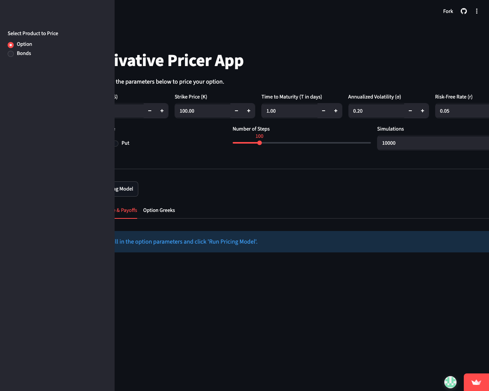

# 🎯 Derivative Pricer App

[](https://deriv-price.streamlit.app/)

A premium, interactive web application built with Streamlit that calculates option prices, bond metrics, and option Greeks using standard quantitative finance pricing models.

---

## 🖥️ Application Preview

<p align="center">
  
</p>

---

## 🚀 Key Features

*   **Option Pricing Models**:
    *   **Binomial Option Pricing Model**: Tree-based numerical method ($N=100$) for American and European options.
    *   **Black-Scholes-Merton (BSM) Model**: Standard analytical closed-form solution for European options.
    *   **Monte Carlo Simulation**: Stochastic path simulation ($50,000$ iterations) for standard European derivatives.
*   **Bond Analytics**: Valuation and yields analysis for fixed-income instruments.
*   **Option Greeks Engine**: Computes first-order and second-order risk sensitivities:
    *   **Delta ($\Delta$)**: Sensitivity to stock price.
    *   **Gamma ($\Gamma$)**: Sensitivity of Delta to stock price.
    *   **Vega ($\nu$)**: Sensitivity to volatility.
    *   **Theta ($\theta$)**: Sensitivity to time decay.
    *   **Rho ($\rho$)**: Sensitivity to risk-free rate.
*   **Dynamic Visualizations**: Real-time option payoff plots showing profit/loss profiles at expiration.

---

## 📂 Project Structure

```
Derivative-Pricer/
├── README.md               # Application documentation
├── main.py                 # Streamlit application entrypoint
├── requirements.txt        # Package dependencies list
├── assets/
│   └── pricer_dashboard.png # Live dashboard UI screenshot
├── engine/                 # Core quantitative pricing engine
│   ├── options/
│   │   ├── binomial.py     # Cox-Ross-Rubinstein tree implementation
│   │   ├── blackscholes.py # BSM analytical formula
│   │   ├── montecarlo.py   # Monte Carlo simulation paths
│   │   └── common.py       # Shared utility functions and payoffs
│   └── bonds/              # Fixed income pricing engine
└── app/                    # Front-end UI components
    └── components/
        └── option_components.py # Streamlit UI input and display widgets
```

---

## 🛠️ Installation & Running

### 1. Set Up Environment

Clone the repository and install dependencies in a virtual environment:

```bash
# Clone the repository
git clone https://github.com/shantanuhumbe/Derivative-Pricer.git
cd Derivative-Pricer

# Setup virtual environment
python3 -m venv venv
source venv/bin/activate

# Install dependencies
pip install -r requirements.txt
```

### 2. Start the App

Launch the Streamlit dashboard server locally:

```bash
streamlit run main.py
```

The app will open automatically in your browser at **`http://localhost:8501`** (or **`http://localhost:8502`** if port 8501 is occupied).